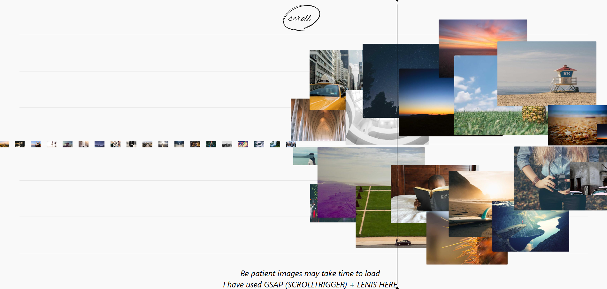

# HeroFlip --- GSAP Scroll Animation

A frontend animation experiment inspired by the portfolio landing page
of **Maria Vasilyeva**.

This project is an **independent redesign/recreation** of the visual
interaction from her portfolio landing page. The goal was to study the
interaction and rebuild the core idea from scratch using React, GSAP,
ScrollTrigger, and Lenis while adding my own implementation and
animation logic.

> **Original inspiration / credit:** Maria Vasilyeva\
> This repository is not the original website and is not affiliated with
> or endorsed by Maria Vasilyeva.

## ✨ Animation

The hero section presents a scattered sequence of image cards controlled
by a vertical scroll/spotlight line.

As the user scrolls:

-   A vertical line travels across the viewport.
-   Image cards move horizontally at a deliberately slower rate.
-   Cards become visually active as the line approaches them.
-   Each card scales and moves vertically according to its custom
    layout.
-   Cards are positioned at different vertical offsets to create a
    scattered editorial composition.
-   The section is pinned while the animation progresses.
-   The sequence can be repeated across an extended scroll distance.
-   Lenis provides smooth scrolling while GSAP handles the animation and
    scroll synchronization.

The slower card movement is intentionally implemented to create a visual
illusion where the spotlight line appears to activate and reveal the
cards.

## 🛠️ Technologies Used

-   **React** --- component structure and rendering
-   **GSAP** --- animation engine
-   **GSAP ScrollTrigger** --- scroll-driven animation and pinning
-   **Lenis** --- smooth scrolling
-   **Tailwind CSS** --- layout and styling

## 🎨 Animation Approach

The animation uses a custom layout for every card:

``` js
{
  y: -240,
  scale: 0.72,
  rotate: -4
}
```

Each card therefore has its own:

-   Vertical position
-   Scale
-   Rotation

The distance between a card and the spotlight line determines its active
amount. That amount is then used to interpolate the card's scale and
vertical position.

The horizontal card movement is intentionally slowed:

``` js
const currentX = baseX - trackProgress * 0.5;
```

This small adjustment creates the main visual illusion of the
interaction.

## 📜 Smooth Scrolling

**Lenis** is used to smooth the page scroll:

``` js
const lenis = new Lenis({
  lerp: 0.08,
  smoothWheel: true,
});
```

Lenis is synchronized with GSAP's ticker, while ScrollTrigger updates
from the Lenis scroll events.

The combination is:

``` text
User Scroll
     ↓
   Lenis
     ↓
Smooth Scroll Position
     ↓
ScrollTrigger
     ↓
Animation Progress
     ↓
Custom Card Calculations
     ↓
GSAP
     ↓
Animated Cards
```

## 📸 Preview



## 📁 Project Structure

``` text
project/
├── screenShots/
│   └── 1.png
├── src/
│   ├── components/
│   │   └── HeroFlip.jsx
│   └── ...
├── README.md
└── ...
```

## 🙌 Inspiration & Credit

The interaction is inspired by the portfolio landing page of **Maria
Vasilyeva**. Her portfolio uses animation and interaction as an
important part of the experience; this project is my own
implementation/reinterpretation of that visual idea. citeturn0search0

**Original creator:** Maria Vasilyeva

This project is intended as a learning, experimentation, and frontend
animation study.

------------------------------------------------------------------------

### Built with curiosity, GSAP, and a little bit of desi jugaad. 🚀
