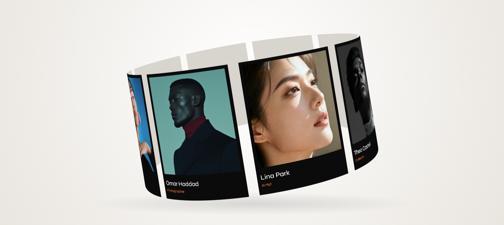

# 🎨 3D Cylindrical Artist Ring Carousel

> A silky-smooth, interactive 3D cylindrical carousel built with **React 19**, **GSAP**, and pure **HTML5 2D Canvas** — inspired by the award-winning design on **[follow.art](https://follow.art)**.

---

[](https://react.dev/)
[](https://greensock.com/gsap/)
[](https://tailwindcss.com/)
[](https://vitejs.dev/)
[](https://opensource.org/licenses/MIT)

---

<p align="center">
  
</p>

---

## 🌟 Acknowledgement & Inspiration

This project is a creative recreation inspired by the mesmerizing circular showcase experience on **[follow.art](https://follow.art)**. Full credit goes to the brilliant designers and creative technologists behind **follow.art** for pioneering this elegant visual aesthetic and interaction pattern!

---

## 📖 Table of Contents

- [✨ Features](#-features)
- [🧠 The Magic Explained (For Absolute Beginners)](#-the-magic-explained-for-absolute-beginners)
  - [1. Why 2D Canvas instead of Three.js?](#1-why-2d-canvas-instead-of-threejs)
  - [2. The Slicing Technique (The Secret Sauce)](#2-the-slicing-technique-the-secret-sauce)
  - [3. Math & Perspective Projection](#3-math--perspective-projection)
  - [4. Double-Sided Cards](#4-double-sided-cards)
  - [5. Off-Screen Canvas Optimization](#5-off-screen-canvas-optimization)
  - [6. Inertia & Touch Physics](#6-inertia--touch-physics)
- [📁 Project Structure](#-project-structure)
- [🛠️ Tech Stack](#️-tech-stack)
- [🚀 Quickstart Guide](#-quickstart-guide)
- [⚙️ Configuration & Tweaking](#️-configuration--tweaking)
- [🎨 Customizing Your Cards](#-customizing-your-cards)
- [💡 Common Questions & Troubleshooting](#-common-questions--troubleshooting)
- [📄 License](#-license)

---

## ✨ Features

- **🌀 Pure 2D Canvas 3D Illusion**: Simulates realistic curved 3D geometry without the overhead of heavy 3D rendering engines (like Three.js or WebGL).
- **🔪 120-Slice Curved Card Rendering**: Each card is cut into 120 micro-vertical strips that map onto a circular ring, producing an authentic cylindrical bend.
- **🔄 Two-Sided Realistic Cards**: Cards display the high-res artist photo and typography when facing front, and reveal a sleek card-stock back when rotated away from the viewer.
- **👆 Silky Touch & Pointer Gestures**: Drag, flick, or swipe to spin the ring; GSAP Observer dynamically calculates inertia and eases back to the resting speed.
- **🌊 Gentle Sine-Wave Wobble**: The entire carousel gently oscillates on a subtle tilt axis (`-0.2` to `-0.12` radians) for an organic, floating feel.
- **⚡ 60+ FPS Offscreen Canvas Cache**: Text and photos are composited into offscreen buffers once, ensuring lightning-fast drawing during every animation frame.
- **📱 Retina / High-DPI Support**: Automatically scales with `window.devicePixelRatio` for crystal-clear visuals on high-resolution displays (MacBook Retina, 4K monitors, modern smartphones).

---

## 🧠 The Magic Explained (For Absolute Beginners)

If you're new to creative coding, canvas, or trigonometry, you might wonder: **"How can a flat 2D canvas show a spinning 3D carousel?"**

Here is the step-by-step breakdown of how it works under the hood:

```
                  Top-Down View of the Ring
                         
                            [Card 1]  (back of ring)
                       . - - - - - - .
                   .                   .
              [Card 8]               [Card 2]
             .                           .
            .                             .
            .                             .
             .                           .
              [Card 7]               [Card 3]
                   .                   .
                       . - - - - - - .
                   [Card 6] [Card 5] [Card 4]
                     (front of ring - closest to camera)
                               👁️
```

### 1. Why 2D Canvas instead of Three.js?
Usually, 3D web animations require libraries like Three.js, shaders, and 3D meshes. While powerful, 3D engines add significant bundle weight and complexity.

This project uses standard **HTML5 Canvas 2D API (`getContext("2d")`)**. By using simple trigonometry, we project 3D coordinates onto a 2D screen, delivering maximum performance with near-zero bundle overhead.

---

### 2. The Slicing Technique (The Secret Sauce)
A flat image drawn on canvas is always rectangular. If you simply rotate a rectangle, it remains flat like a piece of cardboard.

To make the cards **curve organically along the cylinder**, we split each card into **120 tiny vertical strips** (`slicesPerCard = 120`):

```
+------------------------------------------+
| | | | | | | | | | | | | | | | | | ... | |  <- 120 vertical slices
+------------------------------------------+
```

Every single vertical slice is given its own individual angle on the circle! When drawn side-by-side:
- Each slice gets a slightly different scale and height based on its depth.
- The slices seamlessly fit together, creating the illusion of a single smoothly bent card.

---

### 3. Math & Perspective Projection
In `Hero.jsx`, the helper function `pointRing(angle, radius)` calculates where a point on the circle lands on your 2D screen:

```javascript
function pointRing(angle, radius) {
      // 1. Calculate depth (distance from camera):
      //    When cos(angle) = 1, card is closest to the viewer.
      //    When cos(angle) = -1, card is furthest away.
      const depth = Math.cos(angle);

      // 2. Perspective Scale: items closer to us appear larger (up to 1.25x),
      //    items further away appear smaller (down to 0.75x).
      const scale = 1 + depth * 0.25;

      return {
            x: Math.sin(angle) * radius * scale, // Horizontal position
            y: depth * radius * 0.2,             // Vertical tilt position
            scale,                               // Size multiplier
      };
}
```

---

### 4. Double-Sided Cards
In 3D space, when an object faces away from you, you should see its back:

- **Front Face**: When a slice moves left-to-right (`end.x > start.x`), it faces the camera. We draw the textured image slice:
  ```javascript
  cntx.drawImage(card, slice * sliceWidth, 0, sliceWidth, card.height, start.x, top, end.x - start.x + 1, height);
  ```
- **Back Face**: When a slice moves right-to-left (`end.x < start.x`), it faces away from the camera. We draw a neutral warm card-stock color:
  ```javascript
  cntx.fillStyle = "#d8d4ce";
  cntx.fillRect(end.x, top, start.x - end.x + 1, height);
  ```

---

### 5. Off-Screen Canvas Optimization
Drawing high-resolution images and text 60 times a second can cause frame drops if done from scratch.

To keep animations buttery smooth:
1. `createCard(artist)` creates a hidden, virtual canvas (`document.createElement("canvas")`) of size `1200 x 1600` for each artist.
2. The artist photo, name, and role are drawn to this virtual card **only once** when the image loads.
3. During the animation loop (`tick`), the canvas only has to copy pixel strips from the pre-rendered virtual card (`drawImage`), keeping CPU and GPU usage extremely low.

---

### 6. Inertia & Touch Physics
The project integrates **GSAP's `Observer` plugin** and **`gsap.ticker`**:
- When you drag or flick on desktop or mobile, `Observer` records your swipe delta.
- It spikes the ring's rotation speed:
  ```javascript
  const spin = (self.deltaX + self.deltaY) * 0.002;
  gsap.fromTo(ring, { speed: spin }, { speed: normalSpeed, duration: 2, ease: "power3.out" });
  ```
- Over 2 seconds, the speed smoothly glides back to its relaxed cruising velocity (`0.01`).

---

## 📁 Project Structure

```text
pr10/
├── public/                 # Static assets (favicons, etc.)
├── shots/                  # Showcase screenshots and preview media
│   └── 1.png               # High-res preview of the 3D cylindrical carousel
├── src/
│   ├── components/
│   │   └── Hero.jsx        # Core 3D cylinder canvas animation & GSAP logic
│   ├── utils/
│   │   └── constants.js    # Artist data array (names, roles, Lummi photo IDs)
│   ├── App.jsx             # Root React component hosting the Hero
│   ├── global.css          # Tailwind CSS v4 import & radial backdrop gradients
│   └── main.jsx            # React 19 root entry point
├── index.html              # HTML shell loading Syne font & viewport meta
├── package.json            # Project dependencies and npm scripts
├── vite.config.js          # Vite configuration with React & Tailwind plugins
└── README.md               # You are here!
```

---

## 🛠️ Tech Stack

| Technology | Purpose |
| :--- | :--- |
| **React 19** | Component architecture and lifecycle management |
| **GSAP (GreenSock)** | High-performance animation ticker, tweens, and easing |
| **GSAP Observer** | Multi-device touch and pointer gesture detection |
| **@gsap/react** | React hook (`useGSAP`) with automatic cleanup and safe teardown |
| **HTML5 Canvas 2D** | High-performance rendering of the sliced 3D cylinder |
| **Tailwind CSS v4** | Clean modern utility styles & viewport layout |
| **Vite** | Blazing-fast development server and optimized bundler |
| **Google Fonts (Syne)** | Striking editorial typography for artist names and titles |
| **Lummi AI** | Curated stock portraits for creative professionals |

---

## 🚀 Quickstart Guide

Get the project running on your local machine in under 2 minutes:

### Prerequisites
Make sure you have [Node.js](https://nodejs.org/) (version 18+ recommended) installed.

### 1. Clone or Open the Project
```bash
cd "c:\Users\LUCKY BALIYAN\Desktop\Awwards_animations\UsingReact\Pr10"
```

### 2. Install Dependencies
```bash
npm install
```

### 3. Start the Development Server
```bash
npm run dev
```

Open your browser at the local URL shown in your terminal (usually `http://localhost:5173/`).

### 4. Build for Production
To generate an optimized production build:
```bash
npm run build
```

To preview the production build locally:
```bash
npm run preview
```

---

## ⚙️ Configuration & Tweaking

You can easily adjust the look and feel of the carousel in [`src/components/Hero.jsx`](file:///src/components/Hero.jsx):

```javascript
// At the top of Hero.jsx:
const slicesPerCard = 120; // Number of vertical cuts per card (higher = smoother curve)
const gap = 0.1;           // Spacing gap between cards (0.0 to 0.5)
const normalSpeed = 0.01;  // Default idle rotation speed

// Inside useGSAP():
const ring = { 
  angle: 0, 
  speed: normalSpeed, 
  tilt: -0.2               // Overall angle tilt of the cylinder in radians
};
```

| Parameter | Default | Effect |
| :--- | :--- | :--- |
| `slicesPerCard` | `120` | Increase for smoother curves on large screens; decrease (e.g. `60`) for lower-end devices. |
| `gap` | `0.1` | Space between neighboring cards. `0` means cards touch edge-to-edge. |
| `normalSpeed` | `0.01` | How fast the carousel continuously spins when idle. |
| `tilt` | `-0.2` | Vertical tilt angle of the 3D ring. |
| `spin multiplier` | `0.002` | Sensitivity of pointer/swipe drags. |

---

## 🎨 Customizing Your Cards

All card content is defined in [`src/utils/constants.js`](file:///src/utils/constants.js). You can add, edit, or remove artists easily:

```javascript
export const artists = [
  { 
    name: "Elena Marchetti", 
    role: "Artist", 
    photo: "QmeNv2RoYW42tJuohF9cBemdKZ5gU7ScLMrD3GVBn9CrUP" 
  },
  { 
    name: "Kofi Mensah", 
    role: "Curator", 
    photo: "QmdLGVKWQMu2kmADw32js2eN3Tcj856oFfiEWdYeEZbvaP" 
  },
  // Add as many cards as you like! The ring distributes them evenly automatically.
];
```

> **Tip:** The `photo` property currently references Lummi asset hashes (`https://assets.lummi.ai/assets/${artist.photo}`). You can replace this in `Hero.jsx` with any direct image URL (Unsplash, local images in `/public`, Cloudinary, etc.).

---

## 💡 Common Questions & Troubleshooting

<details>
<summary><b>Why do cards appear slightly segmented up close?</b></summary>
Because each card is sliced into vertical strips (`slicesPerCard`). If you want an even smoother curve, bump <code>slicesPerCard</code> from <code>120</code> to <code>160</code> or <code>200</code>.
</details>

<details>
<summary><b>Does this work smoothly on mobile?</b></summary>
Yes! The <code>Observer</code> plugin supports both touch and pointer gestures with <code>preventDefault: true</code>, ensuring swipe gestures spin the carousel instead of scrolling the page.
</details>

<details>
<summary><b>Why is the font checked with <code>document.fonts.load</code>?</b></summary>
Canvas draws text synchronously using whatever font is available at that exact moment. If the Google font ("Syne") hasn't finished downloading yet, canvas falls back to standard system fonts. Using <code>await document.fonts.load("500 80px Syne")</code> ensures text is only rendered after the custom font has fully loaded!
</details>

---

## 📄 License

This project is created for educational and creative portfolio purposes. Released under the [MIT License](LICENSE).

Original visual concept and interaction design inspired by **[follow.art](https://follow.art)**. All artwork and photography belong to their respective creators via Lummi.

